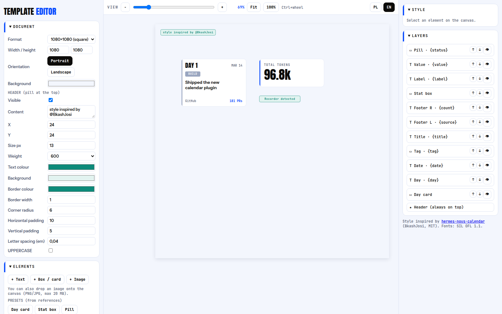
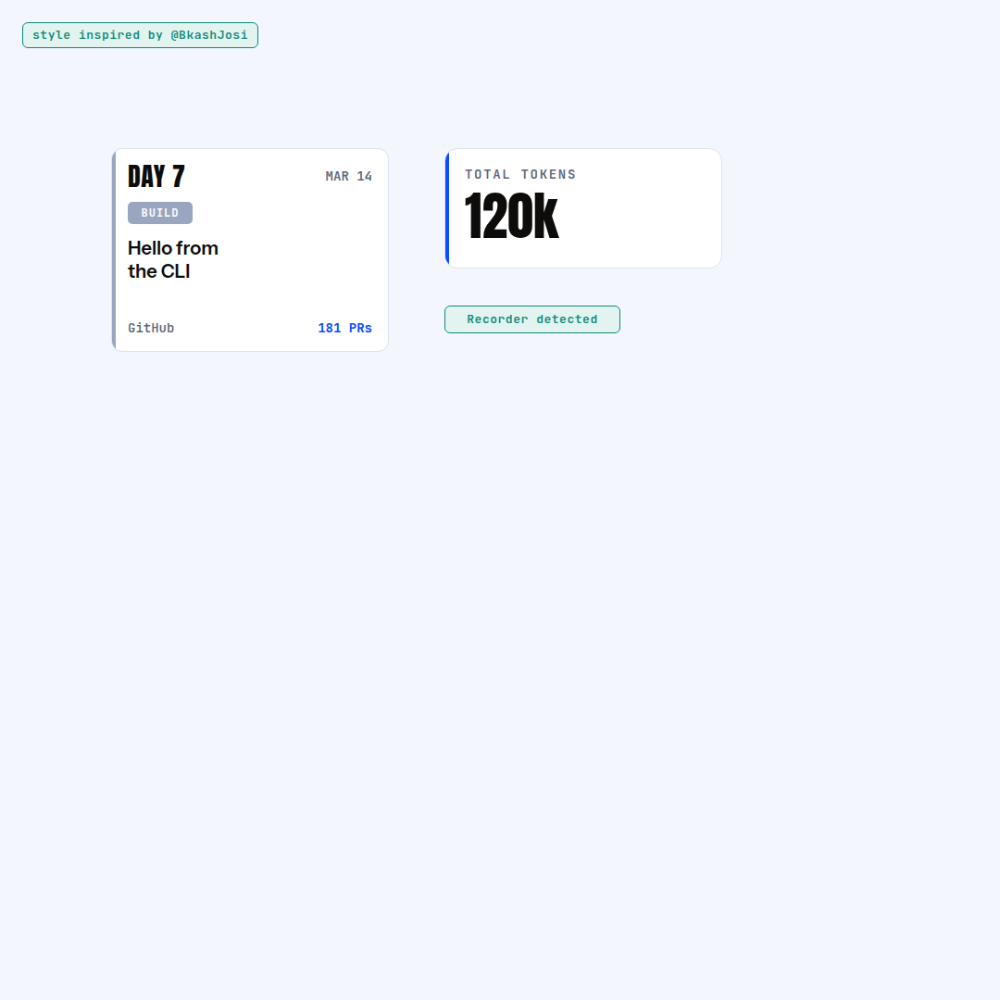

# Style Template Editor

A tiny **local, offline** web editor for social/graphic templates, plus a CLI that fills
template fields and exports pixel-identical PNGs. Python 3 standard library only — no
npm, no cloud, no paid services. PNG rendering uses a headless Chromium/Chrome/Edge you
already have.

> 🇵🇱 Polska wersja: [README.pl.md](README.pl.md)

Visual style inspired by **@BkashJosi** —
[hermes-nous-calendar](https://github.com/BkashJEE/hermes-nous-calendar) (MIT).



| Example output (`render.py`) |
|---|
|  |

## Features

- **Document presets**: 1080×1080, 1080×1350, 1080×1920, 1920×1080, A4 (150/300 dpi), custom; portrait/landscape toggle.
- **Text** anywhere (drag to move): Anton, Instrument Sans, JetBrains Mono (bundled, offline), weight (only real weights — no faux bold), size, colour, letter-spacing, line-height, uppercase, alignment.
- **Boxes / cards**: resizable, background, border, radius, left accent bar (colour/width), configurable shadow (colour, opacity, blur, X/Y offset, spread).
- **Images** (PNG/JPG, drag & drop or file picker): keep-proportions lock (Shift toggles), contain / cover / stretch, opacity, radius, border, left bar, shadow in *frame* or *outline* (drop-shadow, follows transparent PNG shape) mode.
- **Presets** matching the reference style: *Day card*, *Stat box*, *Pill*.
- **Header pill** "style inspired by @BkashJosi" at the top — fully customisable, can be hidden.
- **Collapsible panels**: Document, Elements, Templates, Style, Layers (reorder, hide).
- **View zoom** 10–400 % (slider, −/+, Fit, 100 %, Ctrl+wheel) — view only, never saved.
- **Mouse wheel** changes the focused numeric field / select (Shift ×10, Alt/Ctrl ×0.1).
- **UI language** EN / PL (remembered in the browser and in `settings.json`).
- **Template library** saved as exact JSON files in `templates/`; open / duplicate / delete.
- **Fillable fields**: mark any text or image element with a *Field ID* → fill it from the CLI.
- **PNG export** from the UI and the CLI use the same renderer → identical output.
- Server binds to **127.0.0.1** only.

## Requirements

- Python **3.8+** (standard library only)
- A Chromium-based browser for PNG export: Chromium, Google Chrome or Microsoft Edge.
  Auto-detected; override with the `NT_CHROME` environment variable.

## Install & run

### Linux

```bash
git clone https://github.com/SebMaliszewski/style-template-editor.git
cd style-template-editor
sudo apt install chromium      # or google-chrome; skip if you already have one
./start.sh                     # → http://127.0.0.1:8765
```

**Autostart (systemd user service):**

```bash
./scripts/install-linux-service.sh
sudo loginctl enable-linger "$USER"   # optional: start at boot without logging in
# manage: systemctl --user status|restart|stop style-template-editor
```

### Windows

1. Install [Python 3](https://www.python.org/downloads/) (tick *Add python to PATH*). Chrome or Edge is detected automatically.
2. Download/clone the repo, then double-click **`start.bat`** (or run `powershell -ExecutionPolicy Bypass -File start.ps1`).
3. Open http://127.0.0.1:8765

**Autostart at logon (Task Scheduler):**

```powershell
powershell -ExecutionPolicy Bypass -File scripts\install-windows-autostart.ps1
# remove: Unregister-ScheduledTask -TaskName StyleTemplateEditor -Confirm:$false
```

If the browser is in a non-standard place: `set NT_CHROME=C:\path\to\chrome.exe` (cmd) or `$env:NT_CHROME="..."` (PowerShell).

### macOS (untested)

`python3 server.py` — Chrome/Chromium/Edge in `/Applications` are auto-detected.

### Configuration

| Variable | Default | Meaning |
|---|---|---|
| `NT_PORT` | `8765` | HTTP port |
| `NT_HOST` | `127.0.0.1` | Bind address (keep it local) |
| `NT_CHROME` | auto | Path to Chromium / Chrome / Edge |

## Using the editor

1. **Document** – pick a format and orientation, tweak the header pill.
2. **Elements** – add text, boxes, images or a preset; drag on the canvas, resize with the blue handle, arrows move by 1 px (Shift = 10 px), Delete removes.
3. **Style** – edit everything about the selected element. Give it a **Field ID** to make it fillable.
4. **Templates** – type a name and **Save** → `templates/<name>.json`. **Export PNG** downloads the rendered image.

Opening `http://127.0.0.1:8765/#t=example` loads a template directly; `?lang=en|pl` forces the UI language.

## CLI: `render.py`

```bash
python3 render.py --list                               # templates + their fields
python3 render.py --template example --fields          # fields + default values
python3 render.py --template example \
  --set day="DAY 7" --set title="Hello from\nthe CLI" --set value=120k \
  --out out/day7.png
python3 render.py --template mytpl --set photo=/path/to/photo.jpg --out out/x.png   # image field
```

Only field values change — layout, sizes, colours and fonts always come from the template.
Unknown fields are rejected. `\n` inserts a line break. Image fields accept PNG/JPG paths
(validated by content and copied into `assets/`).

## Template format

Templates are plain JSON in `templates/`:

```json
{
  "version": 1, "w": 1080, "h": 1080, "orientation": "vertical", "bg": "#f3f6fd",
  "header": { "visible": true, "text": "style inspired by @BkashJosi", "x": 24, "y": 24, "...": "..." },
  "elements": [
    { "id": "e2", "type": "text", "text": "DAY 1", "font": "display", "size": 28, "x": 138, "y": 174, "field": "day" },
    { "id": "e8", "type": "box", "w": 300, "h": 130, "bg": "#ffffff", "bar": true, "barColor": "#0a4cff" },
    { "id": "i1", "type": "image", "src": "1a2b3c4d5e6f-photo.png", "w": 400, "h": 300, "fit": "cover", "field": "photo" }
  ]
}
```

- `font`: `display` (Anton) · `body` (Instrument Sans) · `mono` (JetBrains Mono)
- `field`: makes the element fillable from the CLI
- Images live in `assets/` (named by content hash), templates reference them by file name — copy `templates/` **and** `assets/` together.

## AI agent integration (optional)

[`examples/hermes-skill/SKILL.md`](examples/hermes-skill/SKILL.md) is a ready skill for
[Hermes Agent](https://github.com/NousResearch/hermes-agent)-style agents: list templates,
fill fields via the CLI, never invent layout. Adjust the path and copy it into your skills folder.

## Project layout

```
server.py        local HTTP server + JSON API (templates, assets upload, export, settings)
render.py        CLI renderer
ntcore.py        shared helpers (storage, browser detection, PNG export)
static/          editor UI (index.html, i18n.js), shared renderer (render.js), fonts
templates/       your templates (example.json included)
assets/          uploaded images
scripts/         Linux systemd + Windows autostart installers
```

## Credits & licenses

- Style inspired by **@BkashJosi** — [hermes-nous-calendar](https://github.com/BkashJEE/hermes-nous-calendar), MIT. License text: [`third_party/LICENSE-hermes-nous-calendar.txt`](third_party/LICENSE-hermes-nous-calendar.txt).
- Fonts Anton, Instrument Sans, JetBrains Mono — SIL Open Font License 1.1 ([`static/fonts/OFL.txt`](static/fonts/OFL.txt)).
- This project: MIT © Sebastian M ([LICENSE](LICENSE)). Not affiliated with Nous Research.
