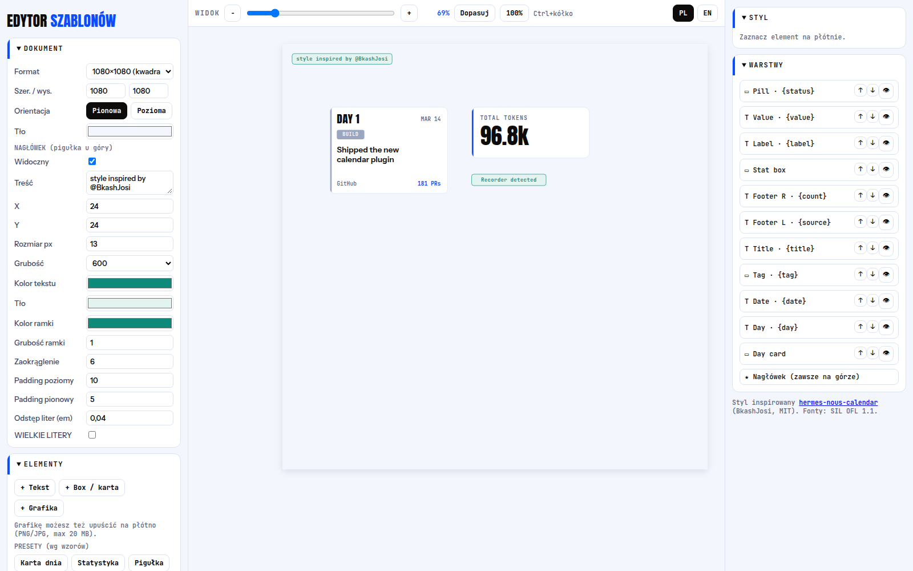

# Style Template Editor 🇵🇱

Mały, **lokalny i offline** edytor szablonów graficznych + CLI, które wypełnia pola
szablonu i eksportuje PNG identyczny z projektem. Tylko biblioteka standardowa Pythona 3;
do PNG używany jest headless Chromium / Chrome / Edge.

Styl inspirowany **@BkashJosi** — [hermes-nous-calendar](https://github.com/BkashJEE/hermes-nous-calendar) (MIT).



## Funkcje

- Formaty 1080×1080, 1080×1350, 1080×1920, 1920×1080, A4, własny; orientacja pionowa/pozioma.
- Teksty w dowolnym miejscu: Anton, Instrument Sans, JetBrains Mono (offline), grubość (tylko istniejące — bez sztucznego pogrubienia), rozmiar, kolor, odstęp liter, interlinia, WIELKIE LITERY, wyrównanie (w tym justowanie) i wyrównanie pionowe góra / środek / dół.
- Boxy/karty: rozmiar, tło, ramka, zaokrąglenie, lewy pasek, konfigurowalny cień.
- Grafiki PNG/JPG (przeciągnij i upuść): proporcje, contain/cover/rozciągnij, krycie, ramka, pasek, cień „ramka” lub „kontur”.
- Presety: Karta dnia, Statystyka, Pigułka. Nagłówek „style inspired by @BkashJosi” (konfigurowalny, można ukryć).
- Zwijane panele, warstwy, zoom widoku 10–400 %, zmiana wartości rolką myszy, język PL/EN.
- Biblioteka szablonów (pliki JSON w `templates/`), pola wypełnialne (ID pola), eksport PNG z UI i CLI.

## Instalacja

**Linux**
```bash
git clone https://github.com/SebMaliszewski/style-template-editor.git
cd style-template-editor
sudo apt install chromium        # jeśli nie masz Chromium/Chrome
./start.sh                       # → http://127.0.0.1:8765
./scripts/install-linux-service.sh   # autostart (systemd --user)
```

**Windows**
1. Zainstaluj Pythona 3 (zaznacz *Add python to PATH*). Chrome/Edge wykrywany automatycznie.
2. Uruchom **`start.bat`** (albo `start.ps1`) i otwórz http://127.0.0.1:8765
3. Autostart: `powershell -ExecutionPolicy Bypass -File scripts\install-windows-autostart.ps1`

Zmienne: `NT_PORT` (8765), `NT_HOST` (127.0.0.1), `NT_CHROME` (ścieżka do przeglądarki).

## CLI

```bash
python3 render.py --list
python3 render.py --template example --fields
python3 render.py --template example --set day="DAY 7" --set title="Linia 1\nLinia 2" --out out/plik.png
```

Zmieniają się wyłącznie wartości pól — układ zawsze pochodzi z szablonu.
Szczegóły formatu JSON i integracji z agentem AI: [README.md](README.md).

## Licencje

Kod: MIT © Sebastian M. Styl: hermes-nous-calendar, BkashJosi (MIT,
[`third_party/`](third_party/LICENSE-hermes-nous-calendar.txt)). Fonty: SIL OFL 1.1.
